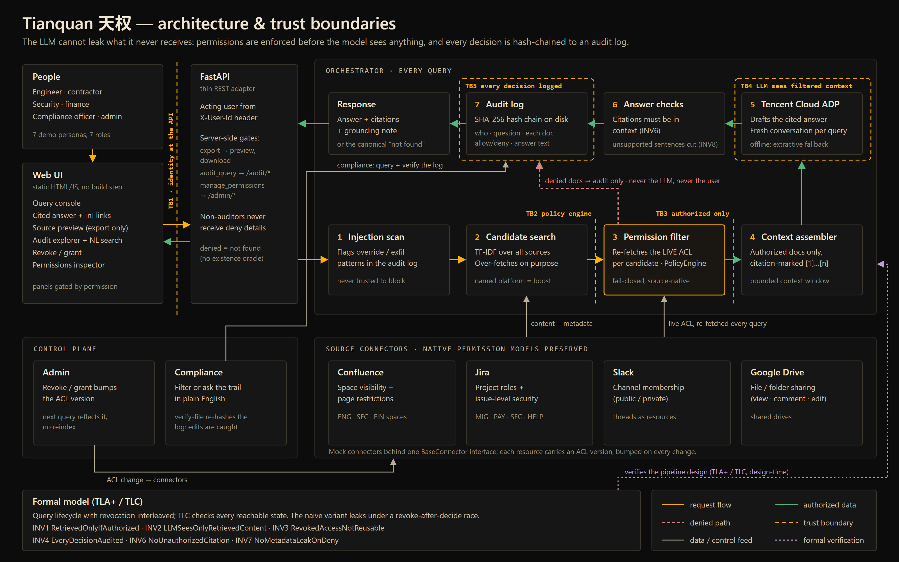

# Project Description — Tianquan 天权

<!-- Generated submission copy, reconciled with implemented behavior on 2026-10-11. Section order follows the handbook's Project Description requirements. -->

## Short blurb

**Permission-safe AI retrieval backed by formal verification.** *(7 words)*

Alternative: *Auditable AI answers that never overstep access rights.* (8 words)

---

## Form version (paste into the submission form)

Plain text, no formatting — the full version follows below.

```text
PROJECT OVERVIEW
Tianquan (天权) is an internal AI assistant for the FinTech track (Aspire "Internal Brain"). It answers questions across Confluence, Jira, Slack and Google Drive with cited sources, for engineers, contractors, security, finance and compliance staff. Its core idea: the LLM cannot leak what it never receives. Every document is checked against the asker's live permissions before the model sees anything, and every decision is written to a tamper-evident audit trail.

REAL-WORLD SCENARIO INSIGHTS
Employees lose an estimated 30% of their week searching across platforms, but an AI assistant that can read everything can also leak everything. In regulated finance, answering a contractor from a restricted incident report is a reportable breach. Tianquan solves this: an engineer gets one cited answer from four systems while restricted documents are withheld; a contractor asking for a restricted report gets the same message as for one that doesn't exist (no side channel); revoking access applies on the very next query; and compliance can ask the audit trail in plain English who accessed what.

SOLUTION DESIGN
Business: a deterministic policy engine (no AI involved) decides access using each platform's native permission model (Confluence spaces, Jira issue security, Slack channels, Drive sharing). Only allowed content reaches the model; viewing or exporting raw sources is a separate, audited permission.
Technical: static dashboard designed with Miora; Python/FastAPI backend; TF-IDF search across all sources; live permission re-check per document; SHA-256 hash-chained append-only audit log. The access-control design is model-checked in TLA+, which found the revocation race the implementation now prevents.
Prompts: the question plus only the permission-filtered, numbered sources are sent to Tencent Cloud ADP (fresh conversation per call, no knowledge base), instructing it to answer only from those sources and cite inline. Citations outside the context are stripped and unsupported sentences are removed by a grounding check.

BUSINESS VALUE
Unblocks internal AI where it is currently too risky: restricted content never reaches the model. Targets the 30% search time with one cited answer across four systems. Revocation is immediate (no reindex window). Audit-ready: every question, allow/deny decision, answer, citation and permission change is recorded, and tampering is flagged at the exact event. Evidence: 6 model-checked safety invariants and 292 passing automated tests. Built with CodeBuddy (development), Tencent Cloud ADP (answers) and Miora (design).
```

---

## 1. Project overview — target scenarios, users and value proposition

**Track:** FinTech (Aspire) — *The Internal Brain: a context-aware enterprise knowledge system with RBAC, security logging and audit trail.*

Tianquan (天权, "heavenly authority") is an internal AI assistant that answers questions across Confluence, Jira, Slack and Google Drive — and is built so that it **cannot leak what it never receives**. Every candidate document is checked against the asker's current permissions, in each platform's own permission model, *before* anything reaches the language model. Every allow, deny, answer and permission change is written to a tamper-evident audit trail that a compliance officer can query in plain English.

**Users.** Engineers, contractors, security, finance and compliance staff at a regulated company — people who need fast, cited answers but must never see more than they are cleared for, and the auditors who must prove it.

**Value proposition.** The productivity of one assistant over all company knowledge, without turning that assistant into a breach vector — plus the evidence trail a regulator asks for. The access-control design is model-checked in TLA+, so its core safety properties are explored exhaustively rather than only tested by example.

## 2. Real-world scenario insights — pain points, audience and core problems solved

**Source of the pain.** The challenge describes a company whose employees lose an estimated **30% of their workweek** searching across platforms. An AI assistant is the obvious fix — but the challenge's own question is the real blocker: *if it can read everything, can it leak everything?* In regulated finance, an assistant that answers a contractor from a restricted incident report isn't a bug; it is a reportable breach.

**Target audience.** FinTechs and banks that want internal AI but cannot deploy it until access control and auditability are demonstrable.

**Core problems solved — each demonstrated with a worked example:**

| Challenge scenario | How Tianquan solves it | Worked example |
|---|---|---|
| Unified natural-language query | Searches all four platforms, filters by permission, answers with numbered citations | Alice's database-migration question is answered from Slack, Confluence and Jira; two matching security documents are withheld from the model |
| Data freshness | Permissions are re-checked live on every query; every citation shows its source's last-updated time | A revoked permission takes effect on the very next query, with no reindex |
| Correct permission enforcement (negative cases) | Denied and nonexistent content return the *identical* message — no existence side channel | Bob (contractor) asks for the Q3 breach report and gets the same answer as a request for a Q5 report that doesn't exist; Charlie (security) asks the same question and gets the report |
| Live permission changes | Admin revoke/grant bumps the resource's ACL version; the next query honours it | Revoking `engineer` on the migration plan removes it from Alice's next answer; the inspector shows her drop out |
| Audit inquiry | Every decision, question, answer, citation and permission change is hash-chained; queryable by filters or plain English | "Show me everything jdoe accessed … in the last 30 days" fills the filters; a hand-edit of the log is flagged at the exact event |

## 3. Comprehensive solution design



**Business architecture.** Tianquan sits between the user and the model. Search proposes candidates; a deterministic policy engine — no AI involved — decides access using each source's native rules (Confluence space/page restrictions, Jira issue security, Slack channel membership, Drive sharing), deny lists, sensitivity clearance and action permissions. Only allowed content is assembled into the prompt. Reading a raw source or exporting it is a separate, audited permission. Auditors get their own gated view of the full history.

**Technical architecture.** A static HTML/JavaScript dashboard (designed with Miora) calls a Python/FastAPI service. Four connectors model each platform's permission semantics behind one interface; new sources plug in through the same interface and get the same permission checks. TF-IDF and character n-gram search ranks candidates across all sources (naming a platform boosts it rather than excluding others). The permission filter re-fetches each candidate's live ACL; the context assembler numbers the allowed sources for citation. The audit trail is an append-only, SHA-256 hash-chained JSON Lines log, re-verified on every audit query.

**How prompts drive the AI generation.** The user's question drives retrieval; the model only enters after filtering. The answer agent calls **Tencent Cloud ADP** with a prompt containing the question and the permission-filtered, numbered sources, instructing it to synthesise a self-contained answer, cite inline, and use only the supplied context. Each call opens a fresh ADP conversation and the agent has no knowledge base, so it can't draw on another user's context or on documents the filter withheld. Citations outside the supplied context are stripped, and a grounding check removes sentences the cited sources don't support and tells the user how many were removed. If nothing is accessible, the model is never called; the user gets the standard "could not find" message.

**Formal verification.** A TLA+ model of the query lifecycle — search, decide, retrieve, answer, audit — with revocation interleaved is exhaustively checked by TLC against six safety invariants (e.g. *RetrievedOnlyIfAuthorized*, *RevokedAccessNotReusable*, *NoMetadataLeakOnDeny*). Changing one line to trust an earlier "allow" instead of re-checking produces a concrete revocation-race counterexample — the reason the implementation re-checks live permissions on every query. The model verifies the design; the Python implementation is tested against the same invariants.

## 4. Business value — defined impact

- **Unblocks AI adoption where it is currently too risky.** Restricted content is withheld before the model call, so the assistant cannot repeat it — the property regulated firms need before putting an LLM over internal data.
- **Targets the 30% search tax** cited in the challenge: one cited answer across four systems instead of a manual hunt through pages, tickets, threads and files.
- **Revocation is immediate.** Off-boarding or pulling a clearance applies on the next query — no reindex window during which stale access is served.
- **Audit-ready by construction.** Each question is one record: who asked, every document allowed or denied, the exact answer and which document each citation came from — plus who changed which permission and when. Tampering is flagged at the exact event.
- **Evidence, not assertion:** 4 platform types and 20 seeded resources, 7 personas, 6 model-checked safety invariants, and **292 passing automated tests**.

Productivity savings have not yet been measured; a pilot would compare time-to-answer and access-incident rates against the organisation's current workflow.

## Tencent Cloud tools used

| Tool | Contribution |
|---|---|
| **CodeBuddy** | Primary development tool: read the challenge, shaped the architecture and decision records, and built the core — policy engine, permission-aware retrieval, TLA+ model, audit trail, API and answer agent (milestones M0–M13). **Proof: [development log with CodeBuddy screenshots](dev-log/dev-log.md#codebuddy-usage-evidence).** |
| **Tencent Cloud ADP** | Generates every live answer from the backend's permission-filtered context (fresh conversation per call, no knowledge base). |
| **Miora** | Designed the dashboard ([original prompt](../frontend/MIORA_PROMPT.md)) and the cover image. |

## Prototype scope

Synthetic data and selectable demo personas stand in for production SSO and live enterprise APIs. The backend holds demo state in one process, so a restart resets permission changes and the audit log. Cloud hosting is planned ([deployment plan](superpowers/plans/2026-10-11-cloud-demo-deployment.md)). The published [ADP agent](https://adp.tencentcloud.com/webim_exp/#/chat/ULzqcG) is a direct chat with the model; the permission-aware experience is the Tianquan app itself. Known limits are tracked in [current state](current-state.md#known-boundaries-and-follow-ups).

[Source repository](https://github.com/jephoton/tianquan-knowledge-agent) · [Architecture](architecture.md) · [Worked examples](demo-runbook.md)
